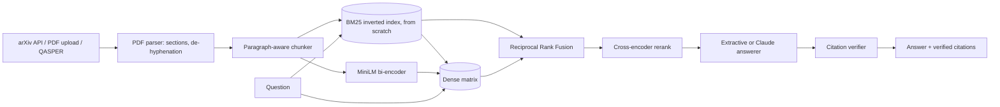

# PaperRAG: Hybrid-Search RAG over Research Papers

**Ask questions about research papers and get answers with verified citations. BM25 + dense retrieval fused with RRF, cross-encoder reranking, a citation verifier, and an evaluation harness on QASPER.**

  [](https://github.com/Alkarim786/research-paper-rag/actions/workflows/ci.yml) [](LICENSE)

## Why
LLM answers about papers are often confidently wrong, with citations that don't support the claim. PaperRAG retrieves evidence with complementary methods, ranks it with a cross-encoder, and **verifies every citation**. Content words must be supported by the cited passage and **no number may be invented**. Every stage is measured.

## Architecture


## Features
- **Ingestion:** polite arXiv client (3 s delay, identifying User-Agent); PDF upload; PDF parsing with heading detection, de-hyphenation and a stop at References.
- **Chunking:** paragraph-aware chunks that never cross a section; long paragraphs split into sentence windows with overlap.
- **Retrieval:** BM25 (Okapi, Lucene IDF) written by hand; dense cosine search; RRF (k=60); cross-encoder reranking; per-paper filtering; per-stage latency reporting.
- **Answering:** extractive answerer (works with no API key; every claim is a verbatim quote) or `AnthropicGenerator` (Claude, JSON with [n] citations). Both go through the verifier.
- **Verification:** content-word support and number checks; groundedness score; citation renumbering.
- **Service:** FastAPI (`/search`, `/ask`, `/ingest/arxiv`, `/ingest/pdf`, `/stats`, `/health`); index persisted to disk; Docker; CI.

**Roadmap:** evaluate the Claude generator (needs an API key; not run), FAISS/HNSW for >1M chunks, an NLI-based citation verifier, query rewriting, streaming answers.

## Evaluation (real results)
Run on 2026-10-19 on an AMD Ryzen 5 7520U (4C/8T, CPU only), Python 3.13.
- **Data:** QASPER validation set (281 NLP papers → 12,017 chunks); 888 answerable questions with text evidence.
- **Setting:** retrieval within each question's paper, the standard QASPER setting.
- **Relevance:** a chunk counts as relevant if it contains a gold evidence paragraph.
- **Models:** all-MiniLM-L6-v2 bi-encoder and ms-marco-MiniLM-L-6-v2 cross-encoder. Index build took 1,139 s on CPU.

| Mode | Recall@1 | Recall@5 | Hit@5 | MRR@10 | nDCG@10 | p50 latency | p95 latency |
|---|---|---|---|---|---|---|---|
| BM25 | 0.155 | 0.431 | 0.586 | 0.384 | 0.401 | 1.1 ms | 2.5 ms |
| Dense | 0.153 | 0.470 | 0.622 | 0.404 | 0.436 | 26.4 ms | 39.1 ms |
| Hybrid (RRF) | 0.190 | 0.501 | 0.662 | 0.445 | 0.470 | 25.6 ms | 37.6 ms |
| **Hybrid + rerank** | **0.212** | **0.541** | **0.715** | **0.482** | **0.497** | 2,026 ms | 2,841 ms |

Hybrid + rerank improves nDCG@10 by **+24% over BM25** and Hit@5 from 0.586 to 0.715. Reranking costs about 2 s per query on this CPU, while other jobs were also running; a GPU or fewer rerank candidates would cut that.

**Extractive answering:**
- Answer token-F1 **0.126**. That's low because QASPER gold answers are short spans, while the answerer returns whole sentences.
- Citation precision **0.231**: share of cited chunks that contain gold evidence.
- Groundedness **1.0**: true by construction for extractive answers.

The LLM generator was **not** evaluated (no API key in this environment).

Reproduce:
```bash
python scripts/download_qasper.py
python -m paperrag.eval.run_eval --papers 0
```

## Quick start
```bash
docker compose up --build        # API docs at http://localhost:8000/docs
curl -X POST localhost:8000/ingest/arxiv -H 'content-type: application/json' -d '{"query":"ti:retrieval augmented generation","max_results":3}'
curl -X POST localhost:8000/ask -H 'content-type: application/json' -d '{"question":"What datasets are used for evaluation?"}'
```
Local: `pip install torch --index-url https://download.pytorch.org/whl/cpu && pip install -e ".[ml,dev]" && uvicorn paperrag.api:app`. Config is via `PAPERRAG_*` env vars (see `.env.example`).

## Testing
`pytest`: 31 tests, using a deterministic hashing embedder and lexical reranker, so CI needs no model downloads. They cover:
- BM25 against hand-computed scores
- RRF, dense masking, all retrieval modes, persistence, incremental add
- chunker boundaries and overlap
- the citation verifier catching a hallucinated number
- LLM-output parsing
- a hand-built PDF round-trip
- the arXiv client against a mock transport
- API validation and PDF upload

## Structure
`paperrag/` (bm25, models, retriever, chunking, grounding, answer, pipeline, api, ingest/, eval/) · `scripts/download_qasper.py` · `tests/` · `Dockerfile` · `docker-compose.yml`

## License
[MIT](LICENSE) © Karim (Alkarim786)
